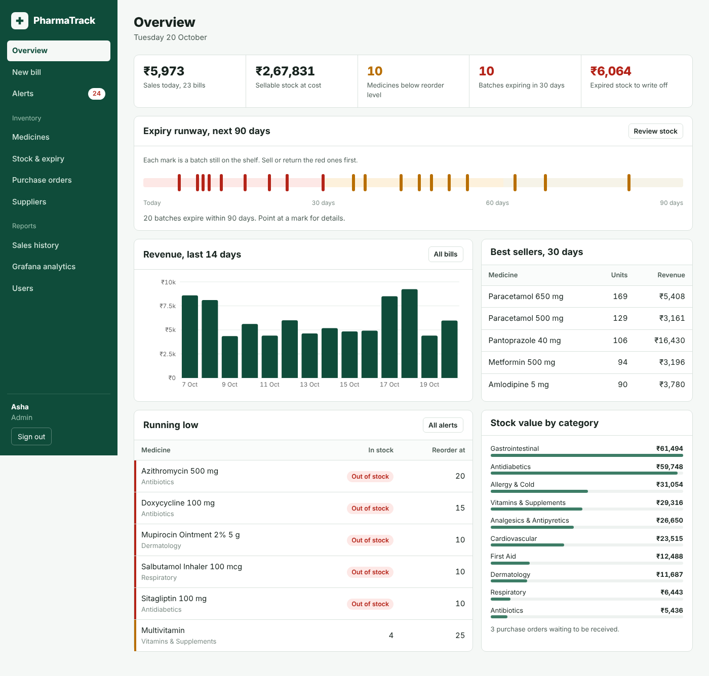

# PharmaTrack: Pharmacy Inventory & Expiry Tracker

A full-stack pharmacy management system. It tracks medicine stock **batch by batch**, bills customers using **FEFO (First Expiry, First Out)**, warns about low stock and expiring medicines, and shows live analytics in **Grafana**.

| Layer | Technology | What it does here |
|---|---|---|
| Frontend | React 19 + Vite, HTML/CSS/JS | Billing counter, inventory screens, alerts, embedded dashboards |
| Backend | Django 5.2 + Django REST Framework | REST API, JWT login, role permissions, FEFO billing logic |
| Database | PostgreSQL 16 | Normalised schema, trigger, reporting views, constraints, indexes |
| Monitoring | Prometheus + Grafana 12 | Inventory, sales and system dashboards, email alerts |
| DevOps | Docker Compose, nginx, Cloudflare Tunnel | One-command start-up, single entry point, HTTPS on your domain |



More screenshots are in [`docs/screenshots/`](docs/screenshots): billing, invoice, stock & expiry, alerts and purchase orders.

---

## 1. Run it (5 minutes)

**Needs:** [Docker Desktop](https://www.docker.com/products/docker-desktop/) (Mac, including Apple Silicon, or Windows) or Docker Engine + Compose (Linux). Every image used is available for both Intel and ARM.

```bash
cd pharmatrack
cp .env.example .env          # Windows PowerShell: copy .env.example .env
# open .env and replace every "change-me" value
docker compose up -d --build
```

The first build takes a few minutes. When it finishes:

| Open | URL | Login |
|---|---|---|
| PharmaTrack app | http://localhost:8080 | `admin` / `admin123` |
| Grafana | http://localhost:8080/grafana | `admin` / the `GRAFANA_ADMIN_PASSWORD` you set |
| Django admin | http://localhost:8080/admin | `admin` / `admin123` |
| Prometheus | http://localhost:9090 | none |

Demo accounts (one per role):

| Username | Password | Role | Can change |
|---|---|---|---|
| `admin` | `admin123` | Admin | Everything, including users |
| `pharmacist` | `pharma123` | Pharmacist | Billing, medicine catalogue |
| `staff` | `staff123` | Store Staff | Stock batches, suppliers, purchase orders |

On first start the backend loads demo data: 40 common Indian-market medicines, 5 suppliers, about 85 batches (some deliberately expired or near expiry, some deliberately low), purchase orders and **90 days of sales history (~1,800 bills)**, so every screen and Grafana panel has something to show.

**Change the demo passwords** before putting the app on the internet (Users page, or Django admin).

### Make the Grafana graphs move during a demo

```bash
docker compose --profile demo up -d      # creates a random bill every ~8 seconds
docker compose stop simulator            # stop it again
```

### Useful commands

```bash
docker compose ps                         # status of every container
docker compose logs -f backend            # follow Django logs
docker compose exec backend python manage.py test inventory        # run the 23 backend tests
docker compose exec backend python manage.py seed_data --reset     # reload fresh demo data
docker compose exec backend python manage.py createsuperuser       # make your own admin
docker compose exec db psql -U pharmatrack                         # SQL shell
docker compose down                       # stop (data is kept)
docker compose down -v                    # stop AND delete all data
```

---

## 2. Put it on your domain with Cloudflare

See **[docs/CLOUDFLARE.md](docs/CLOUDFLARE.md)**. In short:

1. Add your domain to Cloudflare.
2. Create a tunnel in **Zero Trust → Networks → Tunnels**, copy its token into `.env`.
3. Add a public hostname `pharma.yourdomain.com` → `http://frontend:80`.
4. Set `PUBLIC_URL=https://pharma.yourdomain.com` and add the domain to `DJANGO_ALLOWED_HOSTS`.
5. `docker compose --profile tunnel up -d`

HTTPS is handled by Cloudflare, and no ports need opening on your router.

---

## 3. Features

**Billing (Pharmacist)**
- Search by name, brand or ingredient, add to bill, set quantities.
- Stock is taken from the batch that **expires first**, and one line can be split across several batches.
- Expired batches can never be sold. The database itself refuses, see the trigger below.
- Prescription (Rx) medicines require the prescribing doctor's name.
- Discount, payment method (UPI/Cash/Card), printable invoice showing batch numbers and expiry dates.
- Cancel a bill within 24 hours: stock goes back into the original batches.

**Inventory (Store Staff)**
- Medicine catalogue with category, form, strength, price, reorder level and an Rx flag.
- Batch-wise stock with batch number, manufacture date, expiry date, cost price and supplier.
- Purchase orders: create (low-stock items are pre-filled), receive (each line becomes a batch), or cancel.
- Write off expired or damaged stock. It is recorded as a loss and appears in Grafana.

**Alerts**
- Below reorder level, out of stock, expired on the shelf, and expiring in 30/60/90 days.
- Overview page with an **expiry runway**: every batch expiring in the next 90 days placed on a timeline.
- Grafana emails you for low stock, out of stock, batches expiring within 7 days, and the API going down.

**Grafana dashboards** (provisioned automatically, in the *PharmaTrack* folder)
- *Inventory & Expiry*: stock value, low and out of stock, value expiring per week, expiry status mix, category and supplier split, received vs sold, losses from expiry.
- *Sales*: revenue, gross profit, bills, average bill, daily revenue, top medicines by units and profit, busiest hours, payment mix, latest bills, with a category filter.
- *System & API*: API up/down, requests/sec, p50/p95/p99 latency, errors, slowest endpoints, DB queries, bills and logins per minute, CPU, memory and network per container, PostgreSQL transactions.

---

## 4. Architecture

```
                         Internet (optional)
                               │  https://pharma.yourdomain.com
                       ┌───────▼────────┐
                       │  cloudflared   │  Cloudflare Tunnel (outbound only)
                       └───────┬────────┘
   http://localhost:8080       │
                       ┌───────▼────────┐
                       │ frontend nginx │  serves React build + routes:
                       └─┬──────┬─────┬─┘    /api /admin → Django, /grafana → Grafana
                         │      │     │
              ┌──────────▼┐  ┌──▼─────▼──┐
              │  backend  │  │  grafana  │──── reads ────┐
              │  Django   │  └─────┬─────┘               │
              │ /metrics  │        │ queries             │
              └─────┬─────┘  ┌─────▼──────┐              │
        SQL (rw)    │        │ prometheus │              │ SQL (read-only
              ┌─────▼─────┐  └─┬───────┬──┘              │  grafana_reader)
              │ PostgreSQL│◄───┘scrapes└──► cadvisor     │
              │  16       │◄── postgres-exporter         │
              └───────────┘◄─────────────────────────────┘
```

- nginx is the **only** published port, which keeps Cloudflare setup to one hostname.
- Grafana connects to PostgreSQL as **`grafana_reader`**, a read-only role (`default_transaction_read_only = on`), so dashboards can never modify data.
- Prometheus scrapes Django (`django-prometheus` plus custom `pharmatrack_*` counters), PostgreSQL (postgres-exporter) and every container (cAdvisor).

---

## 5. Database design (DBMS)

Full details, ER diagram and sample queries: **[docs/DATABASE.md](docs/DATABASE.md)**.

- **9 tables in 3NF:** `Category`, `Medicine`, `Supplier`, `Batch`, `PurchaseOrder`, `PurchaseOrderItem`, `Sale`, `SaleItem`, `StockWriteOff`.
- **Trigger `trg_sale_item_stock`:** on INSERT it rejects expired batches and overselling, then reduces the batch quantity. On DELETE it restores stock. On UPDATE it rejects the change, because bills are immutable.
- **Views:** `v_medicine_stock`, `v_batch_expiry`, `v_sales_detail`, `v_daily_sales`, `v_stock_loss`, used by both the API and Grafana.
- **Constraints:** CHECKs for expiry after manufacture, available ≤ received, positive quantities and non-negative prices, plus UNIQUE (medicine, batch number).
- **Indexes:** batch expiry date, (medicine, expiry), sale time, sale item medicine.
- **Concurrency:** billing locks the batch rows (`SELECT … FOR UPDATE`) so two counters can't sell the same last strip.

---

## 6. Project structure

```
pharmatrack/
├── docker-compose.yml          all services
├── .env.example                settings template, copy to .env
├── backend/                    Django project
│   ├── config/                 settings, urls
│   └── inventory/              the app
│       ├── models.py           tables
│       ├── migrations/0002_…   trigger + views (raw SQL)
│       ├── services.py         FEFO billing, receiving purchase orders
│       ├── views.py            REST API
│       ├── permissions.py      roles
│       ├── metrics.py          custom Prometheus metrics
│       ├── tests.py            23 tests
│       └── management/commands/seed_data.py, simulate_sales.py
├── frontend/                   React app
│   ├── nginx.conf              gateway routing
│   └── src/pages/              Dashboard, Billing, Medicines, Stock, …
├── db/init/                    creates the read-only Grafana DB user
├── prometheus/prometheus.yml   scrape targets
├── grafana/
│   ├── build_dashboards.py     generates the dashboard JSON
│   ├── dashboards/*.json       3 dashboards
│   └── provisioning/           datasources, dashboard loader, alert rules
└── docs/                       Cloudflare guide, DB design, viva notes
```

---

## 7. API reference

All endpoints are under `/api/` and need `Authorization: Bearer <token>` except login and health.

| Method | Endpoint | Purpose |
|---|---|---|
| POST | `/auth/login/` | `{username, password}` → `{access, refresh}` |
| POST | `/auth/refresh/` | New access token |
| GET | `/auth/me/` | Current user and role |
| GET | `/dashboard/` | Overview figures |
| GET | `/alerts/` | Low stock, expired, expiring |
| CRUD | `/medicines/` | `?search= &category= &low_stock=1` |
| CRUD | `/batches/` | `?status=expired\|critical\|warning\|ok &expiring_within=30` |
| POST | `/batches/{id}/write_off/` | `{quantity, reason}` |
| GET/POST | `/sales/` | Create bill: `{items:[{medicine, quantity}], payment_method, doctor_name, discount}` |
| DELETE | `/sales/{id}/` | Cancel bill (within 24 h) |
| CRUD | `/purchase-orders/` | With nested `items` |
| POST | `/purchase-orders/{id}/receive/` | `{batches:[{item, batch_number, mfg_date, expiry_date}]}` |
| CRUD | `/suppliers/`, `/categories/`, `/users/` (admin) | |
| GET | `/health/` | Liveness check |

Example:
```bash
TOKEN=$(curl -s -X POST localhost:8080/api/auth/login/ -H 'Content-Type: application/json' \
  -d '{"username":"pharmacist","password":"pharma123"}' | python -c "import sys,json;print(json.load(sys.stdin)['access'])")
curl -s localhost:8080/api/alerts/ -H "Authorization: Bearer $TOKEN"
```

---

## 8. Developing without Docker

```bash
# Backend (needs a local PostgreSQL)
cd backend
python -m venv .venv && source .venv/bin/activate    # Windows: .venv\Scripts\activate
pip install -r requirements.txt
export POSTGRES_HOST=localhost POSTGRES_USER=... POSTGRES_PASSWORD=... DJANGO_DEBUG=true
python manage.py migrate && python manage.py seed_data
python manage.py runserver

# Frontend (second terminal), hot reload on http://localhost:5173
cd frontend && npm install && npm run dev
```

After changing a dashboard in `grafana/build_dashboards.py`, run `python grafana/build_dashboards.py`. Grafana picks up the change within 30 seconds.

---

## 9. Troubleshooting

| Problem | Fix |
|---|---|
| `Set POSTGRES_PASSWORD in .env` | You skipped `cp .env.example .env` |
| Port 8080 or 5432 already in use | Change `HTTP_PORT` / `DB_PORT` in `.env` |
| Grafana panels say "permission denied" | The DB volume was created before `db/init` ran. Run `docker compose down -v` and start again (this deletes data) |
| Grafana container CPU/memory panels empty on Windows/Mac | cAdvisor has limited access under Docker Desktop. Everything else still works. On Linux it works fully |
| `DisallowedHost` / 400 on your domain | Add the domain to `DJANGO_ALLOWED_HOSTS` and restart the backend |
| Grafana redirects to localhost on your domain | Set `PUBLIC_URL` to your https address and run `docker compose up -d grafana` |
| No alert emails | Set `SMTP_ENABLED=true` plus SMTP settings. Gmail needs an App Password |

---

## 10. Team

PharmaTrack was built by four of us, each owning one part of the stack:

| Name | GitHub | Part |
|---|---|---|
| Rushil | [@Rushil0700](https://github.com/Rushil0700) | Docker Compose stack, environment template and documentation |
| Krish Viramgama | [@figureitoutkrish](https://github.com/figureitoutkrish) | Django backend and database init scripts |
| Vivaan Jasapara | [@vivaanjasapara707](https://github.com/vivaanjasapara707) | React frontend: billing, inventory, alerts and the Grafana overview |
| Arnav Chaturvedi | [@Arnav-3012](https://github.com/Arnav-3012) | Monitoring: Prometheus and Grafana |
