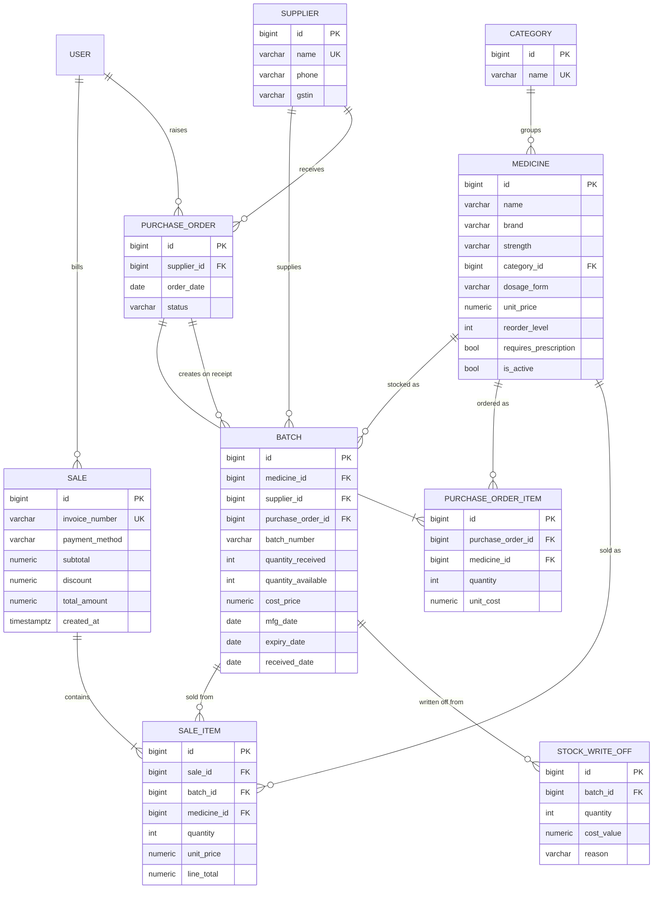

# Database design

PostgreSQL 16. Django creates the tables from `inventory/models.py`. The trigger and views are raw SQL in `inventory/migrations/0002_triggers_and_views.py` and `0004_loss_view.py`, so they are part of the normal `migrate` step.

## ER diagram



(GitHub and VS Code render this diagram. You can also paste it into https://mermaid.live to export a PNG for your report.)

## Why stock lives on the batch, not the medicine
Each delivery has its own expiry date. If stock were a single number on `Medicine`, you couldn't know *which* strips expire next, so you couldn't do FEFO or expiry alerts. A medicine's stock is always **derived** (`SUM(quantity_available)` over its non-expired batches, see `v_medicine_stock`), so it can never drift out of sync.

## Normalisation
- **1NF:** every column is atomic, and a bill's lines are rows in `SaleItem`, not a list inside `Sale`.
- **2NF:** no partial dependency. Every non-key column depends on the whole primary key (all keys are single surrogate ids).
- **3NF:** no transitive dependency. Category name lives only in `Category`, and supplier details only in `Supplier`.
- **Deliberate denormalisation:** `SaleItem.medicine_id` duplicates `Batch.medicine_id`, and `SaleItem.unit_price` / `line_total` copy the price *at the time of sale*. The first speeds up reports. The second is required, because a bill must not change when the catalogue price changes later.

## Integrity rules
| Rule | Where |
|---|---|
| Expiry after manufacture | `CHECK batch_expiry_after_mfg` |
| Available ≤ received | `CHECK batch_available_lte_received` |
| Quantities > 0, prices/discounts ≥ 0 | `CHECK` constraints on each table |
| One batch number per medicine | `UNIQUE (medicine_id, batch_number)` |
| No duplicate catalogue entry | `UNIQUE (name, brand, strength)` |
| Can't delete a medicine/supplier that has history | `ON DELETE PROTECT` foreign keys |
| Can't sell expired stock or more than available | Trigger (below) |
| Bill lines can't be edited | Trigger rejects `UPDATE` |

## Trigger: `trg_sale_item_stock`
`AFTER INSERT OR UPDATE OR DELETE ON inventory_saleitem FOR EACH ROW`

- **INSERT:** locks the batch row, raises an error if the batch expired before the sale date or doesn't have enough units, otherwise `quantity_available -= NEW.quantity`.
- **DELETE** (bill cancelled): `quantity_available += OLD.quantity`.
- **UPDATE:** raises an error.

Because this lives in the database, the rules hold even for SQL typed directly into `psql`. Try it:
```sql
-- pick an expired batch and try to sell from it
INSERT INTO inventory_sale (invoice_number, customer_name, customer_phone, doctor_name, payment_method,
                            subtotal, discount, total_amount, created_at)
VALUES ('TEST-1', '', '', '', 'CASH', 0, 0, 0, now()) RETURNING id;
INSERT INTO inventory_saleitem (sale_id, batch_id, medicine_id, quantity, unit_price, line_total)
SELECT <sale id>, batch_id, medicine_id, 1, 10, 10 FROM v_batch_expiry WHERE status = 'EXPIRED' LIMIT 1;
-- ERROR:  Batch 12 expired on 2026-09-12 and cannot be sold
```

## Views
| View | One row per | Used by |
|---|---|---|
| `v_medicine_stock` | medicine: stock, stock value, nearest expiry, `is_low_stock` | Grafana inventory, alert rules |
| `v_batch_expiry` | batch: days to expiry, status `EXPIRED/CRITICAL/WARNING/OK` | Grafana expiry panels, alert rules |
| `v_sales_detail` | sold line: category, gross profit | Grafana sales |
| `v_daily_sales` | day: bills, revenue, average bill | reports |
| `v_stock_loss` | expired-on-shelf batch or write-off: loss value | Grafana losses |

`pharma_today()` returns today's date in IST so "expired" means the same thing everywhere.

## Indexes
`inventory_batch(expiry_date)`, `inventory_batch(medicine_id, expiry_date)` (the FEFO lookup), `inventory_sale(created_at)`, `inventory_saleitem(medicine_id)`, plus the indexes PostgreSQL creates for every PK, FK and UNIQUE.

Check the FEFO lookup uses its index:
```sql
EXPLAIN ANALYZE SELECT * FROM inventory_batch
WHERE medicine_id = 1 AND quantity_available > 0 AND expiry_date >= pharma_today()
ORDER BY expiry_date;
```

## Transactions and concurrency
`services.create_sale()` runs in one transaction (`@transaction.atomic`). Each candidate batch is read with `SELECT … FOR UPDATE`, so two pharmacists billing the last strip at the same moment are serialised: the second waits, then sees zero stock and gets "only N in stock". If any line fails, the whole bill rolls back.

## Handy queries for the viva
```sql
-- Stock and low-stock status per medicine
SELECT display_name, category, stock, reorder_level, is_low_stock FROM v_medicine_stock ORDER BY stock;

-- What expires in the next 30 days, and how much money is it?
SELECT medicine, batch_number, quantity_available, stock_value, days_to_expiry
FROM v_batch_expiry WHERE status = 'CRITICAL' AND quantity_available > 0 ORDER BY days_to_expiry;

-- Top 5 medicines by profit this month
SELECT medicine, SUM(quantity) units, SUM(gross_profit) profit
FROM v_sales_detail WHERE sold_at >= date_trunc('month', now())
GROUP BY medicine ORDER BY profit DESC LIMIT 5;

-- Revenue per weekday (window function: share of total)
SELECT to_char(day, 'Day') weekday, SUM(revenue) revenue,
       ROUND(100 * SUM(revenue) / SUM(SUM(revenue)) OVER (), 1) AS pct
FROM v_daily_sales GROUP BY 1, extract(isodow FROM day) ORDER BY extract(isodow FROM day);

-- Which supplier's stock gets written off most? (3-table join)
SELECT s.name AS supplier, COUNT(DISTINCT w.batch_id) AS batches, SUM(w.cost_value) AS written_off
FROM inventory_stockwriteoff w
JOIN inventory_batch b    ON b.id = w.batch_id
JOIN inventory_supplier s ON s.id = b.supplier_id
GROUP BY s.name ORDER BY written_off DESC;
```
